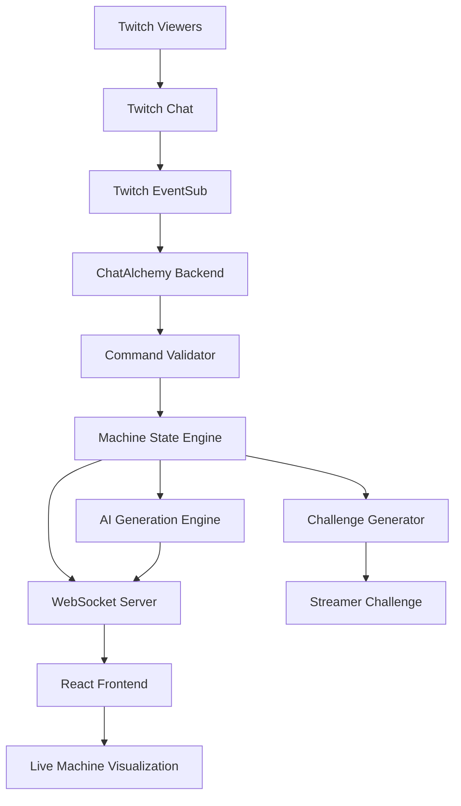

# 🧪 ChatAlchemy

### Transform Twitch Chat into a Collaborative AI-Powered Creation Experience

ChatAlchemy is an interactive, AI-powered Twitch experience that transforms ordinary live-stream conversations into collaborative machine-building adventures.

Instead of simply chatting, Twitch viewers become creators. Through chat commands, viewers collaboratively assemble a virtual machine, contribute components, and influence its final design. AI transforms their collective creativity into a unique machine description and generates challenges for the streamer.

**ChatAlchemy turns Twitch chat into a playground for creativity, collaboration, and interactive entertainment.**

---

## ✨ Overview

Traditional Twitch streams allow viewers to interact through messages, reactions, polls, and channel rewards.

ChatAlchemy takes this interaction further by allowing viewers to actively participate in building something together.

Every valid chat command contributes to a shared machine. As viewers add components, the machine evolves in real time. Once the building session is complete, AI interprets the final configuration, generates its identity and description, and creates an entertaining challenge for the streamer.

### The Core Experience

1. Viewers join a Twitch stream.
2. They interact with ChatAlchemy using chat commands.
3. Valid commands contribute components to a shared machine.
4. The machine evolves as more viewers participate.
5. AI generates a unique identity and description for the machine.
6. A live overlay visualizes the machine's evolution.
7. The final machine configuration generates a challenge for the streamer.

---

## 🎯 Problem Statement

Most live-stream interactions are passive or disconnected from the actual streaming experience.

Viewers send messages, but their contributions rarely have a meaningful impact on what happens next.

ChatAlchemy addresses this by introducing a collaborative creation system where:

- Every viewer can contribute to a shared experience.
- Chat interactions directly influence the machine.
- AI transforms collective contributions into creative outcomes.
- Streamers receive dynamic challenges based on viewer participation.
- The entire process becomes an engaging, real-time experience.

---

## 💡 Our Solution

ChatAlchemy creates a bridge between Twitch chat, artificial intelligence, and interactive entertainment.

It combines:
- Real-time Twitch chat integration.
- Command-based interaction.
- Collaborative machine construction.
- AI-powered creative generation.
- Live machine visualization.
- Dynamic streamer challenges.

The result is an experience where viewers are not just watching the stream. They are helping create it.

---

## 🚀 Key Features

### 1. Twitch Chat Integration
Connects with Twitch chat to receive viewer messages and process interactions in real time.

### 2. Command-Based Building
Viewers use simple commands to contribute different machine components.

Example:

```text
!build engine
!build wings
!build laser
!build shield
```

### 3. Collaborative Machine Creation
Multiple viewers contribute to the same machine, making the final creation a collective effort.

### 4. AI-Powered Generation
AI interprets the assembled components and generates:
- Unique machine names.
- Creative machine descriptions.
- Machine identities.
- Narrative explanations.
- Streamer challenges.

### 5. Live Animated Overlay
A real-time frontend visualization displays the machine as components are added.

### 6. Dynamic Challenge Generation
The final machine configuration becomes the foundation for an entertaining challenge that the streamer must complete.

### 7. Real-Time Synchronization
WebSocket communication keeps the frontend synchronized with backend machine updates.

### 8. Command Validation
The backend validates incoming commands and prevents invalid interactions from modifying the machine.

---

## 🎮 How It Works

### Step 1: Viewers Interact

Viewers send commands through Twitch chat.

```text
!build engine
!build wings
!build laser
```

### Step 2: Commands Are Processed

The backend receives messages and validates the commands.

### Step 3: Machine Components Are Added

Every valid command updates the shared machine configuration.

### Step 4: AI Generates the Machine

AI interprets the assembled components and creates a coherent machine identity and description.

### Step 5: Live Visualization

The frontend receives updates and animates the machine as it evolves.

### Step 6: Challenge Generation

Once the building phase ends, the final machine configuration is used to generate a challenge for the streamer.

---

## 🧩 Example Interaction

Imagine a streamer starts a ChatAlchemy session.

**Twitch Chat:**

```text
viewer_01: !build engine
viewer_02: !build wings
viewer_03: !build laser
viewer_04: !build shield
```

**ChatAlchemy:**

```text
Component added: Engine
Component added: Wings
Component added: Laser
Component added: Shield

Machine assembly complete!
```

**AI-Generated Machine:**

Name: Aether Falcon

Description:

A futuristic flying combat machine equipped with an advanced propulsion engine, aerodynamic wings, a powerful laser system, and an energy shield.

**Generated Challenge:**

Complete a mission without using your primary weapon.

*The example above illustrates the intended experience.*

---

## 🏗️ System Architecture



### Architecture Components

| Component | Responsibility |
|---|---|
| Twitch Integration | Receives Twitch chat messages |
| Command Processor | Identifies supported commands |
| Command Validator | Validates incoming interactions |
| Machine State Engine | Maintains the shared machine configuration |
| AI Engine | Generates creative descriptions and challenges |
| WebSocket Server | Broadcasts real-time updates |
| React Frontend | Displays the interactive experience |
| Challenge Generator | Creates streamer challenges |

---

## 🛠️ Technology Stack

The following represents the intended technology architecture.

| Technology | Purpose |
|---|---|
| React | Frontend development |
| TypeScript | Type-safe frontend development |
| Vite | Frontend build tooling |
| Python | Backend development |
| FastAPI | Backend API framework |
| Twitch EventSub | Twitch chat integration |
| Twitch API | Twitch platform communication |
| WebSockets | Real-time communication |
| OpenAI API | AI-powered creative generation |
| CSS / SVG | Machine visualization and animation |

---

## 📁 Project Structure

```text
ChatAlchemy/
│
├── frontend/
│   ├── public/
│   └── src/
│       ├── components/
│       │   ├── Machine/
│       │   ├── Chat/
│       │   ├── Overlay/
│       │   └── Challenge/
│       ├── hooks/
│       ├── services/
│       ├── types/
│       ├── App.tsx
│       └── main.tsx
│
├── backend/
│   ├── app/
│   │   ├── api/
│   │   ├── twitch/
│   │   ├── engine/
│   │   ├── ai/
│   │   ├── websocket/
│   │   ├── models/
│   │   └── main.py
│   └── tests/
│
├── docs/
├── .env.example
├── .gitignore
└── README.md
```

---

## 💬 Command Reference

| Command | Description |
|---|---|
| `!build engine` | Add an engine |
| `!build wings` | Add wings |
| `!build laser` | Add a laser |
| `!build shield` | Add a shield |
| `!status` | View current machine status |
| `!inventory` | View available components |
| `!help` | Display available commands |
| `!finish` | Finish the building session |

These commands describe the intended command interface.

---

## 🤖 AI Integration

AI is responsible for transforming structured machine configurations into creative experiences.

### AI Capabilities

- Generate unique machine names.
- Interpret combinations of components.
- Generate machine descriptions.
- Create creative narratives.
- Generate dynamic streamer challenges.
- Produce contextual responses.

### Example Input

```json
{
  "components": [
    "engine",
    "wings",
    "laser",
    "shield"
  ],
  "total_builders": 4
}
```

### Example Output

```json
{
  "machine_name": "Aether Falcon",
  "description": "A futuristic flying combat machine.",
  "challenge": "Complete a mission without using your primary weapon."
}
```

The machine state is maintained by deterministic backend logic. AI generates creative outputs based on the validated machine configuration.

---

## ⚡ Real-Time Communication

ChatAlchemy uses WebSocket communication to synchronize machine updates between the backend and frontend.

Example event:

```json
{
  "event": "component_added",
  "data": {
    "component": "engine",
    "viewer": "viewer_01",
    "total_components": 1
  }
}
```

This allows the frontend to respond immediately when viewers contribute components.

---

## 🔐 Security and Reliability

Important security considerations include:

- Secure Twitch authentication.
- Backend-only API credentials.
- Input validation.
- Command cooldowns.
- Rate limiting.
- Duplicate event prevention.
- AI response validation.
- WebSocket connection handling.
- Twitch reconnection support.

---

## ⚙️ Installation and Setup

### Prerequisites

- Node.js
- Python 3.10+
- Git
- Twitch Developer Application
- AI API key, if using an external AI provider

### 1. Clone the Repository

```bash
git clone YOUR_GITHUB_REPOSITORY_URL
cd ChatAlchemy
```

### 2. Frontend Setup

```bash
cd frontend
npm install
npm run dev
```

### 3. Backend Setup

```bash
cd backend

python -m venv venv
```

Activate the virtual environment.

**Windows:**

```powershell
venv\Scripts\activate
```

**Linux/macOS:**

```bash
source venv/bin/activate
```

Install dependencies:

```bash
pip install -r requirements.txt
```

Start the backend:

```bash
uvicorn app.main:app --reload
```

Note: These commands assume the corresponding project files and scripts are present.

---

## 🔑 Environment Variables

Create a `.env` file using the following template:

```env
APP_ENV=development

# Twitch Configuration
TWITCH_CLIENT_ID=
TWITCH_CLIENT_SECRET=
TWITCH_ACCESS_TOKEN=
TWITCH_BOT_USER_ID=
TWITCH_CHANNEL_ID=

# AI Configuration
OPENAI_API_KEY=
AI_MODEL=

# Application URLs
BACKEND_URL=http://localhost:8000
FRONTEND_URL=http://localhost:5173
```

Never commit API keys, access tokens, or other secrets to GitHub.

---

## 🧪 Testing

The project should include tests for:

- Twitch message processing.
- Command validation.
- Machine component addition.
- Machine state updates.
- AI generation.
- Challenge generation.
- WebSocket communication.
- Invalid command handling.
- Duplicate event handling.

Run backend tests:

```bash
pytest
```

Run frontend tests using the configured test runner.

---

## 🗺️ Development Roadmap

| Phase | Planned Work |
|---|---|
| Phase 1 | Twitch integration |
| Phase 2 | Command processing |
| Phase 3 | Collaborative machine engine |
| Phase 4 | AI-powered generation |
| Phase 5 | Live animated overlay |
| Phase 6 | Challenge generation |
| Phase 7 | Integration and testing |
| Phase 8 | Deployment and streaming integration |

---

## 🔮 Future Enhancements

- Multiple machine categories.
- Machine rarity and component tiers.
- Viewer voting.
- Twitch Channel Points integration.
- Multiplayer machine-building competitions.
- Viewer leaderboards.
- Viewer achievements.
- Persistent building sessions.
- Custom streamer challenges.
- AI-generated machine artwork.
- Streamer customization dashboard.
- OBS browser-source integration.
- Session analytics and history.
- Community-specific machine templates.

---

## 🌟 What Makes ChatAlchemy Different?

ChatAlchemy is built around one simple idea:

**What if Twitch chat could build something together instead of just talking?**

It transforms viewers into contributors, messages into meaningful actions, and collective creativity into an interactive streaming experience.

By combining Twitch integration, AI generation, and real-time visualization, ChatAlchemy creates a new way for streamers and communities to interact.

---

## 🤝 Contributing

Contributions, ideas, and feedback are welcome!

1. Fork the repository.
2. Create a feature branch.
3. Implement your changes.
4. Add tests where applicable.
5. Submit a pull request.

```bash
git checkout -b feature/your-feature
git add .
git commit -m "Add: your feature"
git push origin feature/your-feature
```

---

## 📜 License

The project license will be specified once an open-source license has been selected.

---

## 🙌 Acknowledgements

- [Twitch Developer Platform](https://dev.twitch.tv/) — Streaming and chat integration.
- [OpenAI](https://openai.com/) — AI-powered creative generation, if used.
- [React](https://react.dev/) — Frontend development.
- [FastAPI](https://fastapi.tiangolo.com/) — Backend development.
- [Vite](https://vite.dev/) — Frontend tooling.

---

<p align="center">
  <b>ChatAlchemy — Where Chat Becomes Creation.</b>
  <br/>
  Built for interactive streaming, collective creativity, and AI-powered entertainment.
</p>
